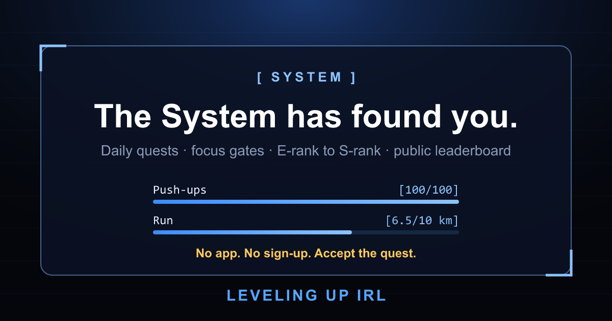

<div align="center">



# Leveling Up IRL

**Your real-life System.** Daily quests, focus gates, hunter ranks and a public leaderboard.<br/>
Open the link and you're playing. No install and no sign-up.

**[level.bsid.dev](https://level.bsid.dev)** · [leveling-up-irl.vercel.app](https://leveling-up-irl.vercel.app)

</div>

---

## What it is

A habit RPG inspired by the hunter "System" from manhwa and anime. You get a Daily Quest
(push-ups, sit-ups, squats, a run), you log it, and you level up from **E-rank** to **S-rank** and beyond.
Miss a day and you land in the **Penalty Zone**.

| | |
|---|---|
| ⚔️ **Daily Quest** | Six tiers, from E (10 · 10 · 10 · 1 km) to S (100 · 100 · 100 · 10 km). Tap to log reps; partial progress still counts. |
| 🔥 **Penalty Zone** | Missed yesterday? Clear today's quest plus 30 burpees and your streak survives. |
| ⏳ **Gates** | A focus timer for study, deep work, reading or training. 1 XP per minute, +20% for clearing the full gate. |
| ✅ **Side quests** | Up to 6 of your own daily habits. |
| 📊 **Status window** | Level, rank, title, STR / AGI / INT / VIT / PER worked out from what you actually did, plus a 12-week heatmap. |
| 🏆 **Leaderboards** | Weekly and all-time, **public to everyone**. To appear, type a name. |
| 🛡️ **Guilds** | Private weekly boards for friends, a hostel or a gym, joined by invite link. |
| 📸 **Share card** | One tap makes a 1080×1920 status image, plus a profile link (`/h/<name>`) with a rich preview. |
| 🔑 **Hunter Key** | Move to another device without an account: a private link restores your progress. |

## Design principles

- **Zero friction.** The first screen is the product. No sign-in wall, ever.
- **Local-first.** Progress lives on your device and works offline. The server only holds the public leaderboard snapshot.
- **Honest numbers.** XP is derived from your activity log, never stored on its own. The server clamps impossible XP gains.
- **Small.** About 20 KB of gzipped JavaScript. One runtime dependency (Preact).

## Stack

| Layer | Choice |
|---|---|
| App | [Preact](https://preactjs.com) + TypeScript, plain CSS, built with Vite |
| API | Vercel Functions (`api/*.ts`, Web `Request`/`Response`) |
| Data | Upstash Redis over REST (sorted sets for the leaderboards) |
| Hosting | Vercel |

## Run it locally

```bash
npm install
npm run dev     # app + API on http://localhost:5173 (in-memory Redis, no setup)
npm test        # game-rule unit tests
npm run build   # type-check + production build
```

To use a real Redis locally, set `KV_REST_API_URL` and `KV_REST_API_TOKEN` (or `UPSTASH_REDIS_REST_*`).
See [`.env.example`](.env.example).

## Project layout

```
api/                 Vercel Functions
  _lib/redis.ts      Upstash REST client (+ in-memory fallback for dev)
  _lib/http.ts       auth, rate limits, validation, anti-cheat helpers
  register.ts        POST: join the board with a name → id + secret token
  sync.ts            POST: push your snapshot (XP clamped by elapsed time)
  leaderboard.ts     GET: weekly / all-time / guild boards (CDN-cached)
  guild.ts           create / join / leave guilds
  profile.ts, h.ts   public profiles + link-preview HTML for /h/<name>
  me.ts              restore with a Hunter Key
src/
  lib/game.ts        all game rules (pure functions, unit-tested)
  lib/store.ts       local state, notices, sync
  views/             Quest, Ranks, Status, Profile, Invite
docs/                plan, decisions, launch
```

## Docs

- [Product plan and market check](docs/PLAN.md)
- [Decisions](docs/DECISIONS.md)
- [Launch plan](docs/LAUNCH.md)

## Privacy

There are no accounts, emails or passwords, and no analytics. Joining a board stores your chosen name and a public
snapshot (level, stats, streak). A hashed device token and a backup of your progress let your Hunter Key restore it.
You can hide yourself from public boards in Settings.

## Credits

A fan-inspired project with original code, art, sounds and wording. It is not affiliated with any publisher.
Made by [Siddharth](https://bsid.dev). MIT licensed.
